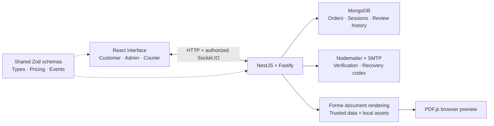

# 🍳 KitchenToDoor

> Fresh from the kitchen, tracked to your door.

**A full-stack TypeScript application connecting customer ordering, kitchen dispatch and live courier tracking—with reusable engineering skills for your next project.**

[Explore the features](#overview) · [Run locally](#quick-start) · [Reuse the skills](#reusable-feature-skills) · [Architecture](documentation/docs/ARCHITECTURE.md) · [Verification](documentation/docs/QUALITY.md)

<p align="left">
  
  
  
  
  
  
  
  
  
  
  
  
  
  
  
  
</p>

---

## Overview

Follow an order from the menu to the doorstep through three connected workspaces:

| Customer                                                                                                   | Administrator                                                                                               | Courier                                                                                |
| ---------------------------------------------------------------------------------------------------------- | ----------------------------------------------------------------------------------------------------------- | -------------------------------------------------------------------------------------- |
| Register and verify email, browse 27 dishes in seven categories, keep a persistent bag and place an order. | Review incoming orders, approve delivery requests, assign couriers and advance dispatch stages.             | Request available deliveries, receive an assignment and manage each delivery stage.    |
| Track your own orders, preview bilingual receipts and request profile/photo changes.                       | Review profile changes with before/after comparisons, feedback and an audit history; manage account access. | Share real device GPS with consent during an active delivery and see review decisions. |

The details make the application useful as a reference project:

- **Order updates:** sequential statuses, cancellation with a required explanation, atomic audit history and authenticated Socket.IO updates.
- **Friendly navigation:** shareable URLs, breadcrumbs, a role-aware drawer that opens by default and remembers its state, themed filters, menu page sizes of 8/16/32/60 (other lists: 10/25/50/100), responsive dark/light themes and inline Zod field errors.
- **Loading feedback:** initial/route/table skeletons, action spinners and a full-page glass loading screen during sign-in, registration and sign-out. Food photos and fonts are hosted locally.
- **Order receipts:** PDFCN's Forme renderer generates English/Japanese receipts from authorized order snapshots, with centered branding, rounded food thumbnails, saved pricing and a separate Order History page. The read-only preview includes a footer download action and embedded Japanese fonts.
- **Profiles and notifications:** customers and couriers submit profile/photo changes for admin approval. Persistent notifications show review decisions, feedback and read status.
- **Appearance and language:** smooth light/dark and EN/JA changes, themed keyboard-accessible tooltips and compact icon actions. Language is remembered on this device and saved to signed-in accounts.
- **Shared login and cart state:** Zustand keeps the user/access token synchronized across tabs and works with rotating HttpOnly refresh cookies. The cart uses an account-scoped localStorage store, so item quantities survive navigation and reloads without mixing separate signed-in accounts.
- **Email security:** OTP codes verify new accounts, sign-ins from new devices and password resets. Codes expire after 10 minutes by default; the resend delay is configurable.

Prices are realistic USD demonstration amounts. Ordering does not collect payment. Street geocoding, delivery zones and jurisdiction-specific tax require the chosen providers and operating location. Device GPS and optional customer current-location pins work independently of geocoding.

## How the application fits together



Order events update the browser's query cache immediately; polling and reconnect refetches reconcile missed updates. Profile-review notifications use durable database records with HTTP polling/open/focus refresh. Receipts are generated from an authorized server snapshot and displayed with no editing controls.

## Engineering decisions to explore

| Problem                                              | Implemented approach                                                                                                         | Where to look                                                                                                                                                    |
| ---------------------------------------------------- | ---------------------------------------------------------------------------------------------------------------------------- | ---------------------------------------------------------------------------------------------------------------------------------------------------------------- |
| A checkout succeeds but its response is lost         | Account-scoped retry keys and a database uniqueness constraint prevent duplicate orders.                                     | [Order service](backend/src/orders/orders.service.ts), [checkout state](frontend/src/lib/checkoutAttempt.ts)                                                     |
| Two staff members update the same delivery           | Conditional atomic updates preserve valid status progression and audit history.                                              | [Order service](backend/src/orders/orders.service.ts)                                                                                                            |
| Access changes while a tracking page remains open    | Session/version checks and recipient authorization prevent stale room membership from granting continued access.             | [Socket gateway](backend/src/orders/orders.gateway.ts), [session service](backend/src/auth/auth.service.ts)                                                      |
| A process stops halfway through profile approval     | A durable applying state and an applied-request marker allow recovery without applying the change twice.                     | [Profile service](backend/src/profiles/profiles.service.ts)                                                                                                      |
| Focus or reconnect triggers a background refresh     | Profile queries skip focus/reconnect refetches, and version-aware shared summaries reject older account details.             | [Profile editor](frontend/src/pages/ProfilePage.tsx), [session store](frontend/src/lib/authSession.ts)                                                           |
| A polished interface must stay usable across devices | Persistent layouts, reduced-motion fallbacks, keyboard tooltips and bounded responsive dialogs accompany the visual effects. | [Transition skill](documentation/reusable-skills/smooth-app-transitions/SKILL.md), [table skill](documentation/reusable-skills/responsive-admin-tables/SKILL.md) |

For a technical interview, demonstrate a customer order, courier request/admin assignment, live status update, profile review and receipt preview. Then explain one concurrency decision and show its verification. The [quality guide](documentation/docs/QUALITY.md) records isolated workflow checks and dated Lighthouse results, including their limits; those historical scores are not presented as measurements of every later build.

## AI-assisted development

This project uses ChatGPT Codex and Google Gemini to assist with implementation, review and documentation. [AGENTS.md](AGENTS.md), the [TypeScript guide](documentation/docs/TYPESCRIPT_GUIDE.md) and scoped [workspace skills](.agents/skills/) supply architecture, version and implementation context. Runtime schemas, type checks, targeted tests and browser verification make the resulting behavior reviewable.

The reusable catalog captures that workflow: inspect the receiving project, adapt the feature to its framework and design tokens, identify configuration, implement the behavior and verify meaningful acceptance criteria. Each skill connects product details with the server/state rules needed to preserve them. This gives an interviewer or contributor concrete code, tradeoffs and verification to discuss alongside the use of AI tools.

## Reusable feature skills

Take an individual folder from [the skill catalog](documentation/reusable-skills/README.md) into another project, or provide its Markdown directly to an LLM. Each skill includes configuration, framework adaptation, acceptance criteria and a map to the implementation here. UI-related skills also explain how to follow the receiving project's design and theme.

| #   | Skill                                                                                                 | Reusable capability                                                                           |
| --- | ----------------------------------------------------------------------------------------------------- | --------------------------------------------------------------------------------------------- |
| 1   | [Smooth app transitions](documentation/reusable-skills/smooth-app-transitions/SKILL.md)               | Route fades and coordinated language/theme crossfades                                         |
| 2   | [Approval notifications](documentation/reusable-skills/approval-notifications/SKILL.md)               | Durable admin reviews, feedback, unread state and history                                     |
| 3   | [Persistent language switching](documentation/reusable-skills/persistent-language-switching/SKILL.md) | Guest/account locale preferences, retry and preserved drafts; includes Next.js adaptation     |
| 4   | [Responsive admin tables](documentation/reusable-skills/responsive-admin-tables/SKILL.md)             | Breadcrumbs, filter/search/settings, column preferences, badges, icon tooltips and pagination |
| 5   | [Profile state and validation](documentation/reusable-skills/profile-state-and-validation/SKILL.md)   | Shared avatars/account state, private uploads, field errors and draft protection              |
| 6   | [Light/dark appearance](documentation/reusable-skills/light-dark-appearance/SKILL.md)                 | Persistent theme action, Sun/Moon icons, tooltip and smooth switching                         |
| 7   | [Secure auth sessions](documentation/reusable-skills/secure-auth-sessions/SKILL.md)                   | Typed authentication, bcrypt/JWT, refresh rotation and current authorization                  |
| 8   | [NestJS/Fastify production API](documentation/reusable-skills/nestjs-fastify-production-api/SKILL.md) | Validated modules, atomic persistence, bounded resources and operations                       |
| 9   | [Typed Socket.IO realtime](documentation/reusable-skills/typed-socketio-realtime/SKILL.md)            | Authorized tracking with a secure adaptation path for chat                                    |
| 10  | [Nodemailer OTP and recovery](documentation/reusable-skills/nodemailer-otp-recovery/SKILL.md)         | Branded OTP flows and a specified recovery-link extension                                     |
| 11  | [PDFCN documents and preview](documentation/reusable-skills/pdfcn-documents-and-preview/SKILL.md)     | Forme/Takumi selection, trusted generation and browser preview                                |
| 12  | [TypeScript quality gates](documentation/reusable-skills/typescript-quality-gates/SKILL.md)           | Testing, lint/format, isolated integration, performance checks and Git gates                  |

The skills preserve behavior across stacks while following the receiving project's colors, typography and components. UI-only features need no secrets; backend skills identify server versus public configuration. **Recovery links, chat and Takumi are documented adaptation paths; the running application currently uses OTP recovery, order tracking and Forme.** A preview has no editing UI, but downloaded PDF copies can still be altered outside the application.

## Technology stack

Receipt previews use **PDF.js (`pdfjs-dist`) 6.4.299** with a local worker. **Sharp 0.35.5** is a backend runtime dependency for validated profile photos and also prepares receipt thumbnails.

| Area                       | Packages / current versions                                                                                                         |
| -------------------------- | ----------------------------------------------------------------------------------------------------------------------------------- |
| Runtime / package manager  | Node **24.x** (verified 24.18.1), pnpm **12.14.0**                                                                                  |
| Language                   | TypeScript **7.0.2**                                                                                                                |
| API                        | NestJS **12.2.0**, Fastify **5.12.7**                                                                                               |
| Database                   | Mongoose **9.11.3**, @nestjs/mongoose **12.0.0**                                                                                    |
| Realtime                   | Socket.IO / socket.io-client **4.8.4**                                                                                              |
| Authentication             | bcryptjs **3.0.3**, @nestjs/jwt **12.0.3**, passport-jwt **4.0.1**                                                                  |
| Security / hosting         | @fastify/helmet **13.2.0**, @fastify/cors **11.3.1**, @fastify/static **10.1.7**, @nestjs/throttler **6.7.1**                       |
| Recovery mail              | Nodemailer **10.2.1** with bundled TypeScript declarations; SMTP configuration required                                             |
| UI                         | React / React DOM **19.3.1**, Zustand **5.0.16**                                                                                    |
| PDF receipts               | PDFCN Forme **@formepdf/core / @formepdf/react 0.28.0**, React **19.3.1**, Sharp **0.35.5** for local WebP-to-JPEG image conversion |
| Japanese fonts             | Fontsource Variable Noto Sans JP **5.3.1**; receipt TTF subsets converted from Fontsource **5.3.1**, SIL OFL 1.1                    |
| Navigation / server state  | TanStack Router **1.170.45**, Query **5.104.5**                                                                                     |
| Localization / tooltips    | i18next **26.5.5**, react-i18next **17.1.2**, Floating UI React **0.27.20**                                                         |
| Styling / animation        | Tailwind CSS + Vite plugin **4.3.3**, Motion **14.6.0**, Lucide **1.61.0**                                                          |
| Build tools                | Vite **8.3.5**, React plugin **6.1.2**; Vite+ **1.3.0** installed                                                                   |
| Contracts                  | Zod **4.6.7**                                                                                                                       |
| Quality tools              | Vitest **5.0.5**, Lighthouse **13.5.0**, Oxlint **1.89.0**, Oxfmt **0.74.0**, Oxc Parser **0.155.0**                                |
| Git gates                  | Husky **9.1.7**, lint-staged **17.6.0**                                                                                             |
| Isolated integration tools | mongodb-memory-server **11.3.0**                                                                                                    |

The manifests specify ranges; pnpm-lock.yaml records exact versions. `pnpm deps:check` checks every direct package against npm. Node declarations follow the supported Node 24 runtime. Current scripts invoke the standalone Vite, Vitest, TypeScript and Oxc tools. Vite+ has a known upstream alias peer warning; application builds and standalone test commands remain verified.

## Quick start

Requirements: Node 24.12 or newer within the 24.x line, pnpm 12.14.0 and a reachable local MongoDB or MongoDB Atlas database.

```bash
cp .env.example .env
pnpm install
node -e "console.log(require('node:crypto').randomBytes(32).toString('hex'))"
```

Set the generated value as JWT_SECRET in the root .env and configure MONGODB_URI. Keep passwords containing `#` quoted. Then:

Before using registration, new-device sign-in or password recovery, configure authenticated SMTP in the root `.env`. The [Gmail SMTP setup](documentation/docs/CONFIGURATION.md#email-otp-and-gmail-smtp) explains how to create and store a Google App Password. Never commit or share that password.

```bash
pnpm dev
```

Open **http://localhost:5173**. The API defaults to port 5000. Use `pnpm dev:frontend` or `pnpm dev:backend` for one server. [Configuration](documentation/docs/CONFIGURATION.md) covers ports, exact Origin allowlists, rate limits, sessions, SMTP and public browser settings.

Choose **EN / JA** beside the cart to switch language. Guest preferences stay in localStorage; registration saves the selected language and signing in restores the account preference. A failed account save keeps the local choice and offers a retry. Changing language preserves the current page, cart and unsaved form inputs. Reduced-motion preferences disable appearance and page animations.

## Accounts and ordering

1. Open **My Account → Create an Account**. You can save an optional delivery address during registration. New accounts are normal customers; registration cannot choose admin/courier privileges. Enter the code sent by email to activate the account and complete sign-in.
2. Add food to the bag and continue to checkout. The cart survives navigation and reloads. Checkout fills in your saved name, phone number and address. Edit any details for this delivery and click **Confirm Order**; these edits do not change your registered defaults. A delivery address is required. You can attach a current-location pin if you are at that address; editing the address clears the pin.
3. **My Orders** shows only your orders. Choose **View Receipt PDF** to open a read-only preview, then **Download Receipt** in its footer. Receipts include food thumbnails, saved prices, delivery details, order status/history and the configured time zone. They are order summaries; the app does not collect payment.
4. Admins see new orders in **Dispatch Station**. **Users → Edit** changes profiles and roles using a themed dropdown. Email/access changes sign the affected user out; they sign in again with their current details.
5. Couriers use **Available Deliveries → Request Delivery**. Admins approve/decline from an order's delivery controls. Once assigned, the order moves to that courier's **My Deliveries** and disappears from other available lists.
6. Admins and the assigned courier can advance each stage in order. Cancellation requires an explanation and is final. Real location sharing is available during OUT_FOR_DELIVERY and stops when the page closes or delivery finishes.

Available delivery summaries omit customer contact/address details until assignment. Tracking URLs do not bypass account permissions. Receipt requests require an authenticated customer who owns the order or an administrator; another customer's receipt returns not found. Old guest orders without an account owner are retained for admin access rather than claimed by matching a phone number.

If a checkout response is lost, retry the same checkout. The app reuses its retry key so the saved order is returned without creating a duplicate. **My Orders** also shows orders that were saved before a connection interruption.

Choose **Sign Out** in the avatar menu to clear this device immediately and revoke existing sessions on the server. If the service cannot be reached, a warning provides a retry action. Email, role, access and password changes invalidate existing sessions and outstanding reset codes. A new browser/device must verify its email code before sign-in.

Choose **Forgot Password?** on the sign-in form, enter your email, verify the code from your inbox, then enter and confirm a new password. Codes expire after 10 minutes by default; the verification form shows the countdown before another code can be requested. Both intervals are configurable.

### Profiles and notifications

Open the avatar menu at the top right and choose **Profile** to edit your details in a modal. The menu shows your photo or a profile icon, name, email and role, with **Sign Out** below Profile. Your email is read-only; ask an administrator to change it. Customers and couriers keep their current details until an admin approves the request. You can preview your own pending photo while it awaits approval. Optional registration photos also await approval. Admins can update their own profile immediately. Password changes require the current password and sign out existing sessions after approval.

The wider Profile modal shows Full Name, Email Address and Phone Number in that order. Contact and password fields use three columns on wide screens, two on tablets and one on phones; the delivery address spans the full row. **Unsaved Changes** appears while editing; Cancel, Back, navigation and Sign Out ask whether to keep editing or discard the draft. Returning to the browser tab preserves your draft. Reloading or closing the tab uses the browser's warning. Password drafts are never saved in localStorage.

The notification bell beside the theme switch shows the unread count and lists the newest updates first. Unread names/messages are bold. Opening a notification marks it read; the envelope action switches between Mark as Read and Mark as Unread. **Remove from Dropdown** hides that update for your account and marks it read, while keeping it on the Notifications page. A later review decision appears again as unread.

**Notifications** keeps the full request history with Review Status → Filter, name/email/feedback search and pagination. Customers and couriers see their own requests and decisions; admins see requests across accounts. The review modal shows timestamps, reviewer details and red/green comparisons of changed fields. Notifications refresh when opened, on focus and at the configured polling interval.

Admins approve changes from the notification modal or reject them with a required explanation. **Users → History** shows profile requests and recorded administrative edits. **Users → Settings** saves visible columns for that administrator in localStorage. Profile photos accept JPEG, PNG and WebP and are normalized before storage.

### Pages and shareable links

| URL                                 | Access / purpose                                         |
| ----------------------------------- | -------------------------------------------------------- |
| `/`                                 | Public food menu; sign-in required to place an order     |
| `/account`, `/account/register`     | Sign-in, registration and profile                        |
| `/account/forgot`, `/account/reset` | Password recovery with email OTP when SMTP is configured |
| `/orders`                           | Signed-in customer orders or courier assignments         |
| `/tracking/:orderId`                | Owner/admin/assigned-courier order details               |
| `/courier`                          | Courier available deliveries; admin oversight permitted  |
| `/courier/:orderId`                 | Assigned-courier/admin delivery controls                 |
| `/dispatch`                         | Admin dispatch station                                   |
| `/users`                            | Admin user management                                    |
| `/profile`                          | Signed-in profile editing and approval requests          |
| `/notifications`                    | Signed-in notifications and review history               |

Filters and pagination are stored in URLs. Direct page loads, refresh and browser Back/Forward are supported. The menu defaults to 8 items; other lists default to 10. The drawer reserves space on desktop and uses a closable overlay on mobile. Its open/closed preference survives refresh through localStorage. Pages use a short fade transition, with reduced-motion support. Drawer destinations preload on hover or keyboard focus. My Orders and Available Deliveries use the full available content width.

### Local staff login

Development creates missing staff from the quoted `ADMIN_DEFAULT_*` and `COURIER_DEFAULT_*` values in .env. The template uses:

- Admin: `admin@kitchentodoor.io` / `KitchenAdmin#2026!Secure`
- Courier: `courier@kitchentodoor.io` / `Courier#2026!Speed`

Changing environment values does not reset an existing account's password. Use your database account's credentials if they differ. Production does not seed these public samples.

### Recover an existing development administrator

Verify the configured email/password and NODE_ENV=development, then explicitly run:

```bash
pnpm auth:reset-dev-admin
```

This updates only the existing configured admin, preserves its role/profile and invalidates its sessions. It refuses production and never promotes a customer.

For service errors, run both servers and check MongoDB readiness. For rate limits, follow the displayed retry interval. Known Vite proxy restart errors now provide one actionable warning and recover when the API returns; check PORT/API_PROXY_TARGET if the API remains unavailable.

## Production use

```bash
pnpm build
pnpm --filter @kitchentodoor/backend start
```

Configure production settings before starting: NODE_ENV=production, SERVE_FRONTEND=true, a real database, JWT secret, authenticated SMTP_HOST/SMTP_USER/SMTP_PASSWORD/SMTP_FROM, HTTPS PUBLIC_APP_URL/FRONTEND_URL and AUTH_COOKIE_SECURE=true. Production startup requires SMTP for account verification. Fastify serves built pages, API and sockets from one origin, including compressed assets and direct page URLs.

On a fresh production database, configure separate BOOTSTRAP_ADMIN_EMAIL/PASSWORD, run `pnpm auth:bootstrap-admin` after building, then remove the bootstrap password. Existing administrators manage roles through Users. [Operations](documentation/docs/OPERATIONS.md) covers supervision, TLS/proxy configuration, backups, readiness, metrics and scaling requirements. Live hosting, payment/geocoding providers and SMTP delivery require your infrastructure configuration.

## Commands and quality gates

All maintained application and tooling code uses TypeScript/TSX. Node 24 runs the tooling's `.ts` entry points directly. `pnpm typecheck` checks all workspaces, strictly checks the tooling and rejects maintained JavaScript files. Production builds generate JavaScript for browsers and Node.

```bash
pnpm typecheck
pnpm locales:check
pnpm test
pnpm test:integration
pnpm build
pnpm test:browser
pnpm test:browser:profiles
pnpm audit:lighthouse
pnpm deps:check
pnpm audit
pnpm lint
```

Integration, browser and Lighthouse commands create isolated synthetic databases and stop their own processes; they do not use development orders. The first integration run may download a MongoDB binary. Browser checks require Chrome; see [quality commands](documentation/docs/QUALITY.md).

The current Lighthouse private-page harness needs an authentication update: it posts email/password without the required device ID and does not complete a possible new-device OTP challenge. For a public-page audit, select `LIGHTHOUSE_PAGES=menu-mobile,menu-desktop` before running the audit command; build first. Existing Lighthouse reports remain dated results for their recorded builds. The [quality-gates reference](documentation/reusable-skills/typescript-quality-gates/references/kitchentodoor.md) describes the harness correction needed for authenticated scenarios.

- **pre-commit:** lint/fix and format staged TypeScript files through lint-staged.
- **pre-push:** TypeScript source policy, workspace/tooling typechecking and maintained source tests.

Local hooks can be bypassed. Required GitHub CI checks and branch protection are recommended in the [quality-gates skill](documentation/reusable-skills/typescript-quality-gates/SKILL.md); this repository does not currently include a GitHub Actions workflow.

## Workspace

```text
backend/src/
  auth/          Login, sessions, recovery, guards
  users/         Admin user management
  profiles/      Profile requests, protected photos, reviews and notifications
  orders/        Orders, courier requests, assignment, sockets
  receipts/      PDFCN/Forme order receipts, fonts and licensed assets
  database/      Schemas, seeding and operator commands
  common/        Validation, limits, hosting and error handling
  operations/    Health/readiness and admin metrics
frontend/src/
  pages/         Account, user management, courier and tracking pages
  components/    Menu, cart, forms, navigation and dispatch table
  hooks/         Auth, queries, dialogs and form helpers
  lib/           API, Zustand auth/cart stores, settings and sockets
  router.tsx     Typed page URLs and access layouts
shared/src/      Catalog, prices, roles, Zod and socket contracts
scripts/         TypeScript browser, Lighthouse and maintenance tools
documentation/
  reusable-skills/  Twelve portable feature skills and implementation references
  docs/            Architecture, configuration, quality and operations guides
```
