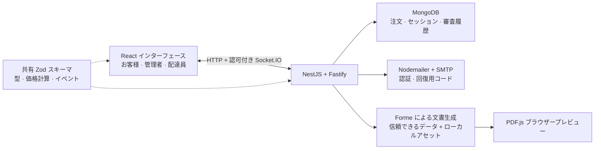

# 🍳 KitchenToDoor

[English](README.md) / **日本語**

> キッチンからご自宅まで。できたての料理を、配達状況とともに。

**お客様の注文、店舗の注文管理、配達員のリアルタイム追跡をつなぐ、フルスタック TypeScript アプリケーションです。他のプロジェクトにも応用できるエンジニアリングスキルをまとめています。**

[機能を見る](#概要) · [ローカルで動かす](#クイックスタート) · [スキルを再利用する](#再利用可能な機能スキル) · [アーキテクチャ](documentation/docs/ARCHITECTURE.md) · [検証記録](documentation/docs/QUALITY.md)

<p align="left">
  
  
  
  
  
  
  
  
  
  
  
  
  
  
  
  
</p>

---

## 概要

お客様・管理者・配達員の 3 つの画面を通じて、メニューの選択から商品のお届けまでを確認できます。

| お客様                                                                                                                  | 管理者                                                                                                   | 配達員                                                                     |
| ----------------------------------------------------------------------------------------------------------------------- | -------------------------------------------------------------------------------------------------------- | -------------------------------------------------------------------------- |
| アカウント登録とメール認証を行い、7 カテゴリ・27 品のメニューから商品を選んで、内容が保存されるカートから注文できます。 | 新規注文の確認、配達リクエストの承認、配達員の割り当て、注文ステータスの更新を行えます。                 | 配達可能な注文をリクエストし、割り当て後は各配達ステータスを管理できます。 |
| 自分の注文の追跡、英語・日本語の領収書プレビュー、プロフィールや写真の変更申請ができます。                              | プロフィールの変更前後の比較、フィードバック、監査履歴を確認し、アカウントのアクセス権限を管理できます。 | 配達中に同意のうえで端末の GPS 位置情報を共有し、審査結果を確認できます。  |

実装例として参照できる、主な機能と工夫を紹介します。

- **注文の更新:** 順序に沿ったステータス遷移、理由の入力が必須のキャンセル、注文の更新と一体で保存される監査履歴、認証付き Socket.IO 更新に対応しています。
- **使いやすいナビゲーション:** 共有可能な URL、パンくずリスト、権限に応じたナビゲーションドロワー、テーマに合わせたフィルターを備えています。ドロワーは初期状態で開き、開閉状態を記憶します。メニューの表示件数は 8/16/32/60 件、その他の一覧は 10/25/50/100 件から選択できます。レスポンシブなライト・ダークテーマと、Zod による項目ごとのエラー表示にも対応しています。
- **読み込み状況の表示:** 初回表示・ページ遷移・テーブル用のスケルトン、操作中のスピナー、ログイン・登録・ログアウト中のガラス調の全画面ローディング表示を用意しています。料理の写真とフォントはローカル配信です。
- **注文の領収書:** PDFCN の Forme レンダラーが、アクセス権限を確認済みの注文スナップショットから英語・日本語の領収書を生成します。中央配置のブランド表示、角丸の料理サムネイル、保存済みの価格、独立した注文履歴ページを備えています。編集操作のないプレビューには、フッターのダウンロードボタンと埋め込みの日本語フォントが含まれます。
- **プロフィールと通知:** お客様と配達員によるプロフィール・写真の変更には管理者の承認が必要です。保存された通知から、審査結果、フィードバック、既読状態を確認できます。
- **表示テーマと言語:** ライト・ダークモードと英語・日本語を滑らかに切り替えられます。テーマに合わせたキーボード操作対応のツールチップと、コンパクトなアイコン操作を備えています。言語設定は端末に記憶され、ログイン中はアカウントにも保存されます。
- **ログインとカートの状態共有:** Zustand がユーザー情報とアクセストークンをタブ間で同期し、ローテーションする HttpOnly リフレッシュ Cookie と連携します。カートはアカウントごとに localStorage へ保存されるため、ページ遷移や再読み込み後も数量が維持され、別のログインアカウントと混在しません。
- **メールによる認証:** 新規アカウント、新しい端末からのログイン、パスワード再設定を OTP コードで確認します。コードの有効期限は標準で 10 分です。再送までの待機時間も設定できます。

価格は実際の相場を参考にした米ドル建てのデモ用金額です。注文時の決済機能はありません。住所のジオコーディング、配達エリア、地域ごとの税制には、利用するサービスや営業地域に応じた設定が必要です。端末の GPS と、お客様が任意で付ける現在地ピンは、ジオコーディングとは独立して動作します。

## アプリケーションの構成



注文イベントはブラウザーのクエリキャッシュへ即座に反映され、ポーリングや再接続時の再取得で取りこぼした更新を補完します。プロフィール審査の通知はデータベースに保存され、HTTP ポーリング、通知を開いたとき、フォーカスが戻ったときに更新されます。領収書は権限確認済みのサーバースナップショットから生成され、編集操作のない画面で表示されます。

## 実装上の判断と確認ポイント

| 課題                                                   | 実装した対策                                                                                                                             | 参照先                                                                                                                                                            |
| ------------------------------------------------------ | ---------------------------------------------------------------------------------------------------------------------------------------- | ----------------------------------------------------------------------------------------------------------------------------------------------------------------- |
| 注文は成功したが、レスポンスが届かない                 | アカウント単位の再試行キーとデータベースの一意制約で、注文の重複を防ぎます。                                                             | [注文サービス](backend/src/orders/orders.service.ts)、[注文確定の状態管理](frontend/src/lib/checkoutAttempt.ts)                                                   |
| 複数のスタッフが同じ配達を更新する                     | 条件付きのアトミック更新で、正しいステータス遷移と監査履歴を維持します。                                                                 | [注文サービス](backend/src/orders/orders.service.ts)                                                                                                              |
| 追跡ページを開いたままアクセス権限が変わる             | セッション・バージョンの確認と受信者ごとの認可により、古いルーム参加状態だけでアクセスが継続されることを防ぎます。                       | [Socket ゲートウェイ](backend/src/orders/orders.gateway.ts)、[セッションサービス](backend/src/auth/auth.service.ts)                                               |
| プロフィール承認の途中でプロセスが停止する             | 適用中の状態と適用済みリクエストの識別情報を永続化し、同じ変更を二重適用せずに復旧できます。                                             | [プロフィールサービス](backend/src/profiles/profiles.service.ts)                                                                                                  |
| フォーカス復帰や再接続でバックグラウンド更新が起きる   | プロフィールのクエリはフォーカス復帰・再接続時の再取得を抑制します。共有するアカウント概要はバージョンを確認し、古い情報を反映しません。 | [プロフィール編集画面](frontend/src/pages/ProfilePage.tsx)、[セッションストア](frontend/src/lib/authSession.ts)                                                   |
| 見た目の工夫と、さまざまな端末での使いやすさを両立する | レイアウトの維持、動きを抑える設定への対応、キーボードで使えるツールチップ、画面内に収まるレスポンシブなダイアログを組み合わせています。 | [画面遷移スキル](documentation/reusable-skills/smooth-app-transitions/SKILL.md)、[テーブルスキル](documentation/reusable-skills/responsive-admin-tables/SKILL.md) |

技術面接では、お客様による注文、配達員のリクエストと管理者による割り当て、リアルタイムのステータス更新、プロフィール審査、領収書プレビューを実演できます。そのうえで、同時実行に関する設計判断を 1 つ選び、検証方法とともに説明すると、実装への理解を示せます。[品質ガイド](documentation/docs/QUALITY.md) には、隔離環境での操作検証と測定日付きの Lighthouse 結果、その限界を記録しています。過去のスコアを、その後のすべてのビルドの測定値として扱うものではありません。

## AI を活用した開発

このプロジェクトでは、実装・レビュー・ドキュメント作成に ChatGPT Codex と Google Gemini を活用しています。[AGENTS.md](AGENTS.md)、[TypeScript ガイド](documentation/docs/TYPESCRIPT_GUIDE.md)、分野別の[ワークスペーススキル](.agents/skills/) が、アーキテクチャ、バージョン、実装方針の前提を提供します。実行時スキーマ、型チェック、対象を絞ったテスト、ブラウザー検証によって、生成された実装の振る舞いを確認できるようにしています。

再利用用カタログには、この開発手順をまとめています。導入先のプロジェクトを調べ、フレームワークとデザイントークンに機能を合わせ、必要な設定を明確にし、実装して、意味のある受け入れ基準を検証します。各スキルは、製品としての細部と、それを支えるサーバー・状態管理のルールを結び付けています。面接やコントリビューションの場で、AI ツールの活用とあわせて、具体的なコード、設計上のトレードオフ、検証結果を説明できます。

## 再利用可能な機能スキル

[スキルカタログ](documentation/reusable-skills/README.md) から必要なフォルダーを別のプロジェクトへコピーするか、Markdown を直接 LLM に渡して利用できます。各スキルには、設定、フレームワークごとの適用方法、受け入れ基準、このリポジトリ内の実装への対応表を含めています。UI 関連のスキルでは、導入先のデザインとテーマを尊重する方法も説明しています。

| #   | スキル                                                                                                    | 再利用できる機能                                                                                 |
| --- | --------------------------------------------------------------------------------------------------------- | ------------------------------------------------------------------------------------------------ |
| 1   | [滑らかな画面遷移](documentation/reusable-skills/smooth-app-transitions/SKILL.md)                         | ページのフェードと、言語・テーマの切り替えに合わせたクロスフェード                               |
| 2   | [承認ワークフローの通知](documentation/reusable-skills/approval-notifications/SKILL.md)                   | 永続化された管理者の審査、フィードバック、未読状態、履歴                                         |
| 3   | [言語切り替えと設定の保存](documentation/reusable-skills/persistent-language-switching/SKILL.md)          | ゲスト・アカウントの言語設定、再試行、編集中の入力の保持。Next.js への適用方法も含みます         |
| 4   | [レスポンシブな管理テーブル](documentation/reusable-skills/responsive-admin-tables/SKILL.md)              | パンくずリスト、フィルター・検索・設定、表示列の保存、バッジ、アイコンのツールチップ、ページ送り |
| 5   | [プロフィールの状態管理と入力検証](documentation/reusable-skills/profile-state-and-validation/SKILL.md)   | アバター・アカウント情報の共有、非公開アップロード、項目エラー、編集中の入力の保護               |
| 6   | [ライト・ダークモード](documentation/reusable-skills/light-dark-appearance/SKILL.md)                      | 表示設定の保存、太陽・月アイコン、ツールチップ、滑らかな切り替え                                 |
| 7   | [安全な認証セッション](documentation/reusable-skills/secure-auth-sessions/SKILL.md)                       | 型を活用した認証、bcrypt/JWT、リフレッシュトークンのローテーション、現在の権限に基づく認可       |
| 8   | [NestJS/Fastify による本番向け API](documentation/reusable-skills/nestjs-fastify-production-api/SKILL.md) | 検証付きモジュール、アトミックな永続化、リソース制限、運用                                       |
| 9   | [型安全な Socket.IO リアルタイム通信](documentation/reusable-skills/typed-socketio-realtime/SKILL.md)     | 認可付きの追跡機能と、チャットへ安全に応用するための方針                                         |
| 10  | [Nodemailer による OTP とパスワード回復](documentation/reusable-skills/nodemailer-otp-recovery/SKILL.md)  | ブランドに合わせた OTP フローと、回復リンクを追加するための設計                                  |
| 11  | [PDFCN による文書生成とプレビュー](documentation/reusable-skills/pdfcn-documents-and-preview/SKILL.md)    | Forme/Takumi の選定、信頼できるデータからの生成、ブラウザープレビュー                            |
| 12  | [TypeScript の品質ゲート](documentation/reusable-skills/typescript-quality-gates/SKILL.md)                | テスト、Lint・整形、隔離した結合テスト、性能検証、Git フックによるチェック                       |

これらのスキルは、導入先の色、書体、コンポーネントに合わせながら、技術スタックをまたいで機能の振る舞いを再現するためのものです。UI だけの機能にシークレットは不要です。バックエンドのスキルでは、サーバー専用設定と公開可能な設定を区別しています。**回復リンク、チャット、Takumi は応用・拡張の設計として説明しています。現在のアプリケーションで実装されているのは、OTP によるパスワード回復、注文追跡、Forme による PDF 生成です。** プレビューに編集機能はありませんが、ダウンロードした PDF のコピーはアプリケーション外で変更できます。

## 技術スタック

領収書プレビューには、ローカル Worker を使う **PDF.js（`pdfjs-dist`）6.4.299** を使用しています。**Sharp 0.35.5** は、プロフィール写真の検証と処理を行うバックエンドの実行時依存で、領収書用サムネイルの準備にも使います。

| 分野                              | パッケージ / 現在のバージョン                                                                                                          |
| --------------------------------- | -------------------------------------------------------------------------------------------------------------------------------------- |
| 実行環境 / パッケージマネージャー | Node **24.x**（24.18.1 で検証）、pnpm **12.14.0**                                                                                      |
| 言語                              | TypeScript **7.0.2**                                                                                                                   |
| API                               | NestJS **12.2.0**、Fastify **5.12.7**                                                                                                  |
| データベース                      | Mongoose **9.11.3**、@nestjs/mongoose **12.0.0**                                                                                       |
| リアルタイム通信                  | Socket.IO / socket.io-client **4.8.4**                                                                                                 |
| 認証                              | bcryptjs **3.0.3**、@nestjs/jwt **12.0.3**、passport-jwt **4.0.1**                                                                     |
| セキュリティ / 配信               | @fastify/helmet **13.2.0**、@fastify/cors **11.3.1**、@fastify/static **10.1.7**、@nestjs/throttler **6.7.1**                          |
| 回復用メール                      | TypeScript 型定義を同梱した Nodemailer **10.2.1**。SMTP 設定が必要です                                                                 |
| UI                                | React / React DOM **19.3.1**、Zustand **5.0.16**                                                                                       |
| PDF 領収書                        | PDFCN Forme **@formepdf/core / @formepdf/react 0.28.0**、React **19.3.1**。ローカル画像の WebP → JPEG 変換には Sharp **0.35.5** を使用 |
| 日本語フォント                    | Fontsource Variable Noto Sans JP **5.3.1**。領収書用の TTF サブセットは Fontsource **5.3.1** から変換し、SIL OFL 1.1 に従います        |
| ナビゲーション / サーバー状態管理 | TanStack Router **1.170.45**、Query **5.104.5**                                                                                        |
| 多言語対応 / ツールチップ         | i18next **26.5.5**、react-i18next **17.1.2**、Floating UI React **0.27.20**                                                            |
| スタイル / アニメーション         | Tailwind CSS + Vite plugin **4.3.3**、Motion **14.6.0**、Lucide **1.61.0**                                                             |
| ビルドツール                      | Vite **8.3.5**、React plugin **6.1.2**。Vite+ **1.3.0** も導入済み                                                                     |
| 共有コントラクト                  | Zod **4.6.7**                                                                                                                          |
| 品質ツール                        | Vitest **5.0.5**、Lighthouse **13.5.0**、Oxlint **1.89.0**、Oxfmt **0.74.0**、Oxc Parser **0.155.0**                                   |
| Git の品質ゲート                  | Husky **9.1.7**、lint-staged **17.6.0**                                                                                                |
| 隔離した結合テスト                | mongodb-memory-server **11.3.0**                                                                                                       |

マニフェストではバージョン範囲を指定し、pnpm-lock.yaml に実際のバージョンを記録しています。`pnpm deps:check` は、すべての直接依存パッケージを npm と照合します。Node の型定義は、サポート対象の Node 24 に合わせています。現在のスクリプトは、単体の Vite、Vitest、TypeScript、Oxc ツールを呼び出します。Vite+ には上流のエイリアスに関する既知のピア依存警告がありますが、アプリケーションのビルドと単体のテストコマンドは動作を検証済みです。

## クイックスタート

必要な環境は、24.x 系の Node 24.12 以降、pnpm 12.14.0、接続可能なローカル MongoDB または MongoDB Atlas です。

```bash
cp .env.example .env
pnpm install
node -e "console.log(require('node:crypto').randomBytes(32).toString('hex'))"
```

生成された値をルートの `.env` の `JWT_SECRET` に設定し、`MONGODB_URI` を指定してください。`#` を含むパスワードは引用符で囲みます。

アカウント登録、新しい端末からのログイン、パスワード回復を利用する前に、ルートの `.env` に認証付き SMTP を設定してください。[Gmail SMTP の設定手順](documentation/docs/CONFIGURATION.md#email-otp-and-gmail-smtp) では、Google アプリパスワードの作成方法と保存方法を説明しています。このパスワードをコミットしたり、他者に共有したりしないでください。

```bash
pnpm dev
```

**http://localhost:5173** を開きます。API の標準ポートは 5000 です。片方のサーバーだけを動かす場合は、`pnpm dev:frontend` または `pnpm dev:backend` を使います。[設定ガイド](documentation/docs/CONFIGURATION.md) には、ポート、厳密な Origin 許可リスト、レート制限、セッション、SMTP、ブラウザーに公開する設定をまとめています。

カートの横にある **EN / JA** で言語を切り替えられます。ゲストの設定は localStorage に保存され、登録時には選択した言語がアカウントに保存されます。ログイン時にはアカウントの言語設定が復元されます。アカウントへの保存に失敗した場合も端末上の選択は維持され、再試行できます。言語を変更しても、現在のページ、カート、未保存のフォーム入力は保持されます。動きを抑える設定が有効な場合は、表示切り替えとページ遷移のアニメーションを無効にします。

## アカウントと注文

1. **マイアカウント → アカウントを作成する** を開きます。登録時には、任意で配達先住所を保存できます。新規アカウントは通常のお客様として作成され、登録画面から管理者・配達員の権限を選ぶことはできません。メールで届いたコードを入力するとアカウントが有効になり、ログインが完了します。
2. 料理をカートに追加し、注文手続きへ進みます。カートの内容はページ遷移や再読み込み後も保持されます。注文手続きでは、保存済みの名前、電話番号、住所が入力されます。今回の配達用に必要な情報を変更し、**注文を確定** を押してください。この変更は登録済みの既定値には反映されません。配達先住所は必須です。その住所にいる場合は、現在地ピンを付けることもできます。住所を変更するとピンは解除されます。
3. **自分の注文** には、自分が注文した内容だけが表示されます。**領収書 PDF を表示** で編集操作のないプレビューを開き、フッターの **領収書をダウンロード** から保存できます。領収書には、料理のサムネイル、保存済みの価格、配達情報、注文ステータスと履歴、設定済みのタイムゾーンが含まれます。これは注文内容の概要であり、アプリケーションでの決済を示すものではありません。
4. 管理者は **注文管理** で新規注文を確認できます。**ユーザー → 編集** では、テーマに合わせたドロップダウンを使ってプロフィールや権限を変更できます。メールアドレスやアクセス権限を変更すると、対象ユーザーはログアウトされ、最新のアカウント情報で再ログインする必要があります。
5. 配達員は **配達可能な注文 → 配達をリクエスト** を使います。管理者は注文の配達操作画面から承認・却下できます。割り当て後の注文は、その配達員の **担当の配達** に移動し、他の配達可能な注文一覧からは表示されなくなります。
6. 管理者と担当の配達員は、各ステータスを順番に進められます。キャンセルには理由が必要で、取り消すことはできません。実際の位置情報の共有は `OUT_FOR_DELIVERY` の間に利用でき、ページを閉じるか、配達が終了すると停止します。

配達可能な注文の概要では、割り当てが完了するまでお客様の連絡先や住所は表示されません。追跡 URL が分かっても、アカウントのアクセス権限を回避することはできません。領収書の取得には、注文した本人である認証済みのお客様、または管理者の権限が必要です。他のお客様の領収書を要求した場合は、見つからないものとして扱います。所有アカウントがない過去のゲスト注文は管理者向けに保持し、電話番号の一致だけで利用者の注文として扱うことはありません。

注文確定時のレスポンスが届かなかった場合は、同じ注文手続きを再試行してください。同じ再試行キーを使うため、重複した注文を作らずに保存済みの注文を取得できます。通信が途切れる直前に保存された注文も、**自分の注文** で確認できます。

アバターメニューの **ログアウト** を選ぶと、その端末のログイン状態をすぐに解除し、サーバー上の既存セッションも失効させます。サービスに接続できない場合は、再試行できる警告を表示します。メールアドレス、権限、アクセス状態、パスワードの変更では、既存セッションと未使用のパスワード再設定コードが無効になります。新しいブラウザーや端末からのログインには、メールのコードによる確認が必要です。

ログイン画面の **パスワードをお忘れですか？** を選び、メールアドレスを入力し、受信したコードを確認してから、新しいパスワードを確認用入力とあわせて設定します。コードの有効期限は標準で 10 分です。認証フォームには、再送が可能になるまでのカウントダウンが表示されます。有効期限と再送間隔は、どちらも設定できます。

### プロフィールと通知

右上のアバターメニューから **プロフィール** を選ぶと、モーダルで情報を編集できます。メニューには、写真またはプロフィールアイコン、名前、メールアドレス、権限が表示され、プロフィールの下に **ログアウト** があります。メールアドレスは読み取り専用のため、変更は管理者に依頼してください。お客様と配達員の情報は、管理者が承認するまで現在の内容が維持されます。承認待ちの自分の写真はプレビューできます。登録時に任意で追加した写真も承認対象です。管理者は自分のプロフィールを即座に更新できます。パスワードの変更には現在のパスワードが必要で、承認後に既存セッションがログアウトされます。

横幅を広く取ったプロフィールモーダルには、お名前、メールアドレス、電話番号がこの順に並びます。連絡先とパスワードの項目は、広い画面では 3 列、タブレットでは 2 列、スマートフォンでは 1 列になります。配達先住所は行全体を使います。編集中は **未保存の変更があります** と表示され、キャンセル、戻る、ページ移動、ログアウト時に、編集を続けるか変更を破棄するかを確認します。ブラウザーのタブへ戻っても編集中の内容は保持されます。再読み込みやタブを閉じる際は、ブラウザー標準の警告を使います。編集中のパスワードが localStorage に保存されることはありません。

テーマ切り替えの横にある通知ベルには未読件数が表示され、新しい更新から順に並びます。未読通知の名前とメッセージは太字になります。通知を開くと既読になり、封筒の操作で「既読にする」と「未読にする」を切り替えられます。**通知メニューから非表示にする** は、そのアカウントのメニューから対象の更新を隠して既読にしますが、通知ページの履歴には残ります。その後に審査結果が更新されると、再び未読として表示されます。

**通知** ページにはすべての申請履歴を保存し、審査状況の選択と絞り込み、名前・メールアドレス・フィードバックの検索、ページ送りに対応しています。お客様と配達員は自分の申請と結果だけを確認でき、管理者はアカウントをまたいで確認できます。審査モーダルには日時、審査担当者、変更項目の赤・緑による比較が表示されます。通知は、開いたとき、フォーカスが戻ったとき、設定されたポーリング間隔で更新されます。

管理者は通知モーダルから変更を承認するか、理由を入力して却下できます。**ユーザー → 履歴** には、プロフィール申請と記録済みの管理者による編集を表示します。**ユーザー → 設定** では、その管理者が表示する列を localStorage に保存します。プロフィール写真は JPEG、PNG、WebP に対応し、保存前に正規化します。

### ページと共有可能なリンク

| URL                                 | アクセス権限 / 用途                                      |
| ----------------------------------- | -------------------------------------------------------- |
| `/`                                 | 公開の料理メニュー。注文にはログインが必要               |
| `/account`, `/account/register`     | ログイン、登録、プロフィール                             |
| `/account/forgot`, `/account/reset` | SMTP 設定時に利用できる、メール OTP によるパスワード回復 |
| `/orders`                           | ログイン中のお客様の注文、または配達員への割り当て       |
| `/tracking/:orderId`                | 注文者・管理者・担当配達員が確認できる注文詳細           |
| `/courier`                          | 配達員向けの配達可能な注文。管理者も監督のために閲覧可能 |
| `/courier/:orderId`                 | 担当配達員・管理者による配達操作                         |
| `/dispatch`                         | 管理者向けの注文管理                                     |
| `/users`                            | 管理者向けのユーザー管理                                 |
| `/profile`                          | ログイン中のプロフィール編集と承認申請                   |
| `/notifications`                    | ログイン中の通知と審査履歴                               |

フィルターとページ送りの状態は URL に保存されます。URL からの直接表示、再読み込み、ブラウザーの戻る・進むに対応しています。メニューの初期表示は 8 件、その他の一覧は 10 件です。ドロワーはデスクトップでは表示領域を確保し、モバイルでは閉じられるオーバーレイになります。開閉設定は localStorage に保存され、再読み込み後も維持されます。ページには短いフェード遷移を適用し、動きを抑える設定にも対応しています。ドロワーのリンクは、ホバーまたはキーボードフォーカス時に遷移先を先読みします。「自分の注文」と「配達可能な注文」は、利用できるコンテンツ幅を全体に使います。

### ローカル環境のスタッフログイン

開発環境では、`.env` に引用符付きで指定した `ADMIN_DEFAULT_*` と `COURIER_DEFAULT_*` の値を使って、未作成のスタッフを追加します。テンプレートの値は次のとおりです。

- 管理者: `admin@kitchentodoor.io` / `KitchenAdmin#2026!Secure`
- 配達員: `courier@kitchentodoor.io` / `Courier#2026!Speed`

環境変数の値を変更しても、既存アカウントのパスワードは再設定されません。異なる場合は、データベース内のアカウントに対応する認証情報を使ってください。本番環境では、これらの公開サンプルアカウントは作成されません。

### 既存の開発用管理者アカウントの回復

設定したメールアドレス・パスワードと `NODE_ENV=development` を確認してから、明示的に次を実行します。

```bash
pnpm auth:reset-dev-admin
```

設定された既存の管理者だけを更新し、権限とプロフィールを維持したまま、そのセッションを無効にします。本番環境では実行できず、お客様を管理者へ昇格させることもありません。

サービスエラーが発生した場合は、両方のサーバーを起動し、MongoDB の準備状態を確認してください。レート制限が表示された場合は、指定された再試行間隔に従います。既知の Vite プロキシの再起動エラーでは、対処方法を示す警告を 1 回表示し、API の復帰時に回復します。API が利用できないままの場合は、`PORT` と `API_PROXY_TARGET` を確認してください。

## 本番環境での利用

```bash
pnpm build
pnpm --filter @kitchentodoor/backend start
```

起動前に、本番環境の設定を用意してください。`NODE_ENV=production`、`SERVE_FRONTEND=true`、実際に接続するデータベース、JWT シークレット、認証付きの `SMTP_HOST` / `SMTP_USER` / `SMTP_PASSWORD` / `SMTP_FROM`、HTTPS の `PUBLIC_APP_URL` / `FRONTEND_URL`、`AUTH_COOKIE_SECURE=true` が必要です。本番起動には、アカウント認証用の SMTP が必須です。Fastify が、ビルド済みページ、API、Socket.IO を同じオリジンから配信します。圧縮アセットとページ URL への直接アクセスにも対応しています。

新規の本番データベースでは、専用の `BOOTSTRAP_ADMIN_EMAIL` と `BOOTSTRAP_ADMIN_PASSWORD` を設定し、ビルド後に `pnpm auth:bootstrap-admin` を実行してから、初期作成用パスワードを削除してください。既存の管理者は「ユーザー」画面で権限を管理します。[運用ガイド](documentation/docs/OPERATIONS.md) には、プロセス監視、TLS・プロキシ設定、バックアップ、準備状態の確認、メトリクス、スケーリングの要件をまとめています。実際のホスティング、決済・ジオコーディングサービス、SMTP 配信には、利用するインフラの設定が必要です。

## コマンドと品質ゲート

管理対象のアプリケーションと開発ツールのコードは、すべて TypeScript/TSX で記述しています。Node 24 がツールの `.ts` エントリーポイントを直接実行します。`pnpm typecheck` は、すべてのワークスペースとツールを厳密に型チェックし、管理対象の JavaScript ファイルを検出すると失敗します。本番ビルドでは、ブラウザーと Node 向けの JavaScript を生成します。

```bash
pnpm typecheck
pnpm locales:check
pnpm test
pnpm test:integration
pnpm build
pnpm test:browser
pnpm test:browser:profiles
pnpm audit:lighthouse
pnpm deps:check
pnpm audit
pnpm lint
```

結合テスト、ブラウザー検証、Lighthouse のコマンドは、テストデータ用の隔離データベースを作成し、自分で起動したプロセスを終了します。開発用の注文データは使用しません。結合テストの初回実行では、MongoDB バイナリがダウンロードされる場合があります。ブラウザー検証には Chrome が必要です。[品質検証コマンド](documentation/docs/QUALITY.md) を参照してください。

現在の Lighthouse の認証付きページ用テストには、認証処理の更新が必要です。メールアドレスとパスワードだけを送信しており、必須の端末 ID を含めず、新しい端末向けの OTP 認証が必要になった場合にも対応していません。公開ページだけを測定するには、先にビルドし、`LIGHTHOUSE_PAGES=menu-mobile,menu-desktop` を設定してから監査コマンドを実行してください。既存の Lighthouse レポートは、記録されたビルドに対する測定日付きの結果です。[品質ゲートのリファレンス](documentation/reusable-skills/typescript-quality-gates/references/kitchentodoor.md) には、認証付きシナリオで必要なテスト処理の修正を説明しています。

- **pre-commit:** lint-staged を使い、ステージ済みの TypeScript ファイルを Lint・修正・整形します。
- **pre-push:** TypeScript ソースのポリシー確認、ワークスペース・ツールの型チェック、管理対象のソースコードのテストを実行します。

ローカルのフックは回避できます。[品質ゲートのスキル](documentation/reusable-skills/typescript-quality-gates/SKILL.md) では、GitHub CI の必須チェックとブランチ保護を推奨しています。このリポジトリには、現時点で GitHub Actions のワークフローは含まれていません。

## ワークスペース

```text
backend/src/
  auth/          ログイン、セッション、回復、認証ガード
  users/         管理者によるユーザー管理
  profiles/      プロフィール申請、保護された写真、審査、通知
  orders/        注文、配達リクエスト、割り当て、Socket.IO
  receipts/      PDFCN/Forme の注文領収書、フォント、ライセンス付きアセット
  database/      スキーマ、初期データ、運用者向けコマンド
  common/        検証、制限、配信、エラー処理
  operations/    生存確認・準備状態の確認、管理者向けメトリクス
frontend/src/
  pages/         アカウント、ユーザー管理、配達員、追跡の各ページ
  components/    メニュー、カート、フォーム、ナビゲーション、注文管理テーブル
  hooks/         認証、クエリ、ダイアログ、フォーム用ヘルパー
  lib/           API、Zustand の認証・カートストア、設定、Socket.IO
  router.tsx     型付きページ URL とアクセス権限ごとのレイアウト
shared/src/      カタログ、価格、権限、Zod、Socket.IO のコントラクト
scripts/         TypeScript のブラウザー検証、Lighthouse、保守ツール
documentation/
  reusable-skills/  12 の移植可能な機能スキルと実装リファレンス
  docs/            アーキテクチャ、設定、品質、運用の各ガイド
```
