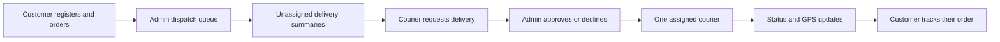

# Architecture

KitchenToDoor is a pnpm workspace with a React application, a NestJS/Fastify API and shared TypeScript/Zod contracts. Supported runtime: Node 24 and pnpm 12.14.0. Current versions include React 19.3.1, Tailwind CSS 4.3.3, Zustand 5.0.15, TanStack Router 1.170.45, Query 5.104.5, Zod 4.6.7, Motion 14.4.0, NestJS 12.2.0, Fastify 5.12.7, Mongoose 9.11.2 and Socket.IO 4.8.4. See [DEPENDENCIES.md](DEPENDENCIES.md) for the complete inventory.

## Accounts and workspaces

| Account | Pages and permissions |
| --- | --- |
| Visitor | Menu and account/recovery pages. Ordering, history, tracking and staff workspaces require sign-in. |
| User (`CUSTOMER`) | Register without choosing a privileged role, order food, and read only orders linked to their user ID. |
| Courier (`COURIER`) | View available delivery summaries, request assignment, and manage approved assignments. |
| Admin (`ADMIN`) | View dispatch, approve/decline requests, assign couriers and edit users. |

The drawer hides inaccessible links; `AccountRequired` also gates direct URLs. Backend JWT/role guards and record checks authorize private reads, mutations, socket joins and protected broadcasts. The UI is not an authorization boundary, as explained in [TanStack's route documentation](https://tanstack.com/router/latest/docs/guide/authenticated-routes).

## Frontend state

| State | Owner |
| --- | --- |
| User and access token | Vanilla Zustand singleton; selective React subscriptions through `useAuth`. |
| Orders, delivery summaries, users, pricing and session verification | TanStack Query. Account-specific keys and cancellation/removal of private caches on identity changes. |
| Page, order, filters and pagination | TanStack Router URLs, real links, refresh and browser history. |
| Cart, dialogs and form drafts | React state. Root layout retains the cart during SPA sign-in/registration. |
| Navigation drawer | React state initialized from localStorage; defaults open and persists both states under kitchentodoor.navigation.open. |

`authSession.ts` explicitly persists the existing `ktd_token`/`ktd_user` keys; Zustand persist middleware is not used. Storage events synchronize tabs. `/auth/me` refreshes the saved profile at startup, focus and the configured verification interval. Passwords and refresh tokens never enter Zustand or localStorage.

An authenticated 401 triggers one refresh attempt and one retry. A single in-tab promise and Web Locks serialize rotation across tabs. Late responses cannot clear a newer login or restore a session after logout. Network/503 errors preserve the saved session. Socket.IO and optional map animation load after the first paint opportunity; live queries reconcile after connection and continue polling on interruption. Sockets reconnect when the token changes. Breadcrumbs use real parent links and aria-current. Menu sizes are 8/16/32/60; other list sizes remain 10/25/50/100.

## Authentication and user management

- bcryptjs 3.0.3 hashes passwords with a configurable work factor, default 12.
- Access JWTs default to 15 minutes. Each private request/event checks the current user, disabled flag, token version and session, instead of trusting an old role claim.
- Opaque refresh secrets rotate through an HttpOnly, SameSite=Strict cookie scoped to `/api/auth`; only hashes are stored. Recognized token reuse revokes its session. Sessions have absolute expiry and a MongoDB TTL index.
- Logout revokes all sessions through token versioning. Email/role/access changes also increment the version. Admin edits use `updatedAt` compare-and-set and append bounded management history inside the same user update.
- Admins cannot disable/demote their own account. Active deliveries must be reassigned/completed before removing courier access.
- Nodemailer 10.1.7 delivers configured SMTP recovery mail. Reset tokens are hashed, expiring and consumed atomically; the browser receives the token in a URL fragment. Recovery is disabled until configured. SMTP delivery is not a durable job queue.
- Development seeds missing configured staff and preserves existing passwords. Production startup does not seed users; explicit first-admin provisioning requires operator credentials and refuses an existing administrator or occupied email.

## Orders, assignment and audit

The shared 27-item catalog supplies canonical names, photos and prices. The server recalculates totals in cents and ignores submitted prices. New `KTD-` numbers have 48 random bits and bounded duplicate-key retries. Opaque tracking IDs are hashed in storage; URLs still require ownership or assignment. Legacy guest orders are not claimed merely by matching a phone number.

Creation stores its first audit entry inside the order. Status, cancellation, delivery requests and assignment append audit records in the same atomic document write. Legacy external logs are merged/deduplicated for reads. Conditional status/revision filters reject competing changes. Majority journaled writes protect acknowledged changes in the tested MongoDB stop/restart scenario. See current [Mongoose updates](https://mongoosejs.com/docs/tutorials/findoneandupdate.html) and [MongoDB write concern](https://www.mongodb.com/docs/manual/reference/write-concern/).

Available-delivery DTOs contain order number, items, total, stage, creation time and the caller's request status. They omit customer contacts/address, location and other requests. Couriers cannot self-assign or read unassigned full details. Admin approval conditionally selects one courier and removes the order from all available lists.

Statuses advance sequentially from PLACED through DELIVERED. Admins and the assigned courier can advance them. Every active stage can be cancelled with a 5–500 character explanation. Terminal stages are final; cancellation retains the explanation and activity history for the customer.

## Location and realtime updates

Couriers explicitly opt in to device GPS after starting their assigned delivery. Updates are throttled, timestamped, and rejected when stale, reordered, terminal or unauthorized. Sharing stops on page exit/completion. Customers can attach their current location at checkout; a written address alone is not silently geocoded or given random coordinates.

The radar illustrates progress, not street navigation. An optional administrator simulator is disabled by default and separate from real courier sharing. Motion uses `LazyMotion`, `motion/react-m`, `domAnimation` and reduced-motion handling; the menu does not load tracking animations.

Socket.IO has configurable connection/IP packet budgets, handshake attempts, concurrent connections, payload and room limits, and upgrade Origin checks. IP budgets survive reconnects. Protected events and broadcasts revalidate current access. `orders:changed` contains no order/customer identifiers. Limits are process-local; deployment topology requirements are in [OPERATIONS.md](OPERATIONS.md).

## Validation, loading and assets

Shared Zod contracts validate requests. `useZodForm` validates blur/submission, focuses the first error and links red inline messages to invalid fields. Status DTOs use `safeExtend`, retaining cancellation refinement on HTTP and socket paths.

`shared/zod` configures browser `jitless` before constructing schemas, avoiding a CSP `unsafe-eval` allowance while leaving server schema configuration unchanged. See [Zod maintainer guidance](https://github.com/colinhacks/zod/issues/4461).

Initial HTML, routes, order tables and actions expose loading feedback. Local responsive WebP images have dimensions, attribution and fallbacks. Fonts are self-hosted with licenses. The menu loads eagerly, other pages are split, and the LCP image is prioritized. Private pages deliberately use `noindex,nofollow`.

## Runtime

Vite proxies `/api` and `/socket.io`. Known unavailable/restart errors produce an actionable warning once per error code until recovery; unexpected errors remain visible. Fastify can serve the compiled SPA/API/sockets with direct-route fallback, Brotli/gzip assets, immutable hashed files and strict CSP. The theme initializer is embedded by Vite and permitted by its exact SHA-256 hash read from built HTML. Rebuild both packages together.

Health/readiness endpoints distinguish process and database state. Admin-only metrics expose handler counters/timing and memory, without customer data. Database failures produce readable 503 errors and queries do not buffer indefinitely. See [CONFIGURATION.md](CONFIGURATION.md), [OPERATIONS.md](OPERATIONS.md) and [QUALITY.md](QUALITY.md).
