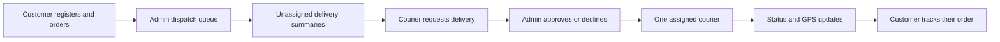

# Architecture

KitchenToDoor is a pnpm workspace with a React application, a NestJS/Fastify API and shared TypeScript/Zod contracts. Supported runtime: Node 24 and pnpm 12.14.0. Current versions include React 19.3.1, Tailwind CSS 4.3.3, Zustand 5.0.16, TanStack Router 1.170.45, Query 5.104.5, Zod 4.6.7, Motion 14.6.0, NestJS 12.2.0, Fastify 5.12.7, Mongoose 9.11.3 and Socket.IO 4.8.4. See [DEPENDENCIES.md](DEPENDENCIES.md) for the complete inventory.

## TypeScript source and tooling

Maintained application, test and tooling code uses `.ts`/`.tsx`. `tsconfig.tools.json` adds strict, no-emit checks for root tools, backend fixtures, frontend compression and test configuration. Explicit type-only imports keep runtime imports separate from erased declarations. `pnpm source:check` rejects maintained `.js`, `.mjs`, `.cjs` and `.jsx` files; ignored build output and dependencies are outside this source policy.

Tool entry points use erasable TypeScript and run through [Node 24's native type stripping](https://nodejs.org/docs/latest-v24.x/api/typescript.html), stable from 24.12. Node does not typecheck them; the separate compiler gate does. The isolated server still loads compiled Nest modules so decorator metadata and production behavior match the built API. The backend owns fixture dependencies, and typed IPC messages describe its readiness/failure responses. Browser commands and events use Chromium's maintained DevTools Protocol declarations.

The early initializer is authored in `frontend/src/theme.ts`. Vite's current [transformWithOxc API](https://vite.dev/guide/api-javascript.html#transformwithoxc) compiles and embeds it in development and production HTML. The API derives the allowed SHA-256 hash from that exact built script. Application builds emit JavaScript for the browser and Node; NodeNext `.js` import specifiers refer to these compiled outputs.

## Accounts and workspaces

| Account             | Pages and permissions                                                                                  |
| ------------------- | ------------------------------------------------------------------------------------------------------ |
| Visitor             | Menu and account/recovery pages. Ordering, history, tracking and staff workspaces require sign-in.     |
| User (`CUSTOMER`)   | Register without choosing a privileged role, order food, and read only orders linked to their user ID. |
| Courier (`COURIER`) | View available delivery summaries, request assignment, and manage approved assignments.                |
| Admin (`ADMIN`)     | View dispatch, approve/decline requests, Assign Couriers and edit users.                               |

The drawer hides inaccessible links; `AccountRequired` also gates direct URLs. Backend JWT/role guards and record checks authorize private reads, mutations, socket joins and protected broadcasts. The UI is not an authorization boundary, as explained in [TanStack's route documentation](https://tanstack.com/router/latest/docs/guide/authenticated-routes).

## Frontend state

| State                                                               | Owner                                                                                                                              |
| ------------------------------------------------------------------- | ---------------------------------------------------------------------------------------------------------------------------------- |
| User and access token                                               | Vanilla Zustand singleton; selective React subscriptions through `useAuth`.                                                        |
| Orders, delivery summaries, users, pricing and session verification | TanStack Query. Account-specific keys and cancellation/removal of private caches on identity changes.                              |
| Page, order, filters and pagination                                 | TanStack Router URLs, real links, refresh and browser history.                                                                     |
| Cart                                                               | Account-scoped vanilla Zustand store with explicit localStorage and cross-tab synchronization.                                    |
| Dialogs and form drafts                                             | React state. Account changes dismiss open account/checkout dialogs; profile drafts stay in memory.                               |
| Navigation drawer                                                   | React state initialized from localStorage; defaults open and persists both states under kitchentodoor.navigation.open.             |
| Theme and language                                                  | Device theme in `ktd_theme`; EN/JA in `ktd_language`, with a scoped account preference and monotonic `languageVersion` in MongoDB. |

`authSession.ts` explicitly persists the existing `ktd_token`/`ktd_user` keys; Zustand persist middleware is not used. Storage events synchronize tabs. `/auth/me` refreshes the saved profile at startup, focus and the configured verification interval. Passwords and refresh tokens never enter Zustand or localStorage.

An authenticated 401 triggers one refresh attempt and one retry. A single in-tab promise coalesces rotation; one Web Lock coordinates login, registration, rotation, password reset and logout across tabs. An in-tab queue is the fallback when Web Locks are unavailable. Superseded authentication responses cannot restore a signed-out session or replace a newer sign-in. Logout clears local state before and after server revocation, and displays pending/failure feedback with a retry action. Network/503 errors preserve saved access state and the refresh cookie. Socket.IO and optional map animation load after the first paint opportunity; live queries reconcile after connection and continue polling on interruption. Sockets reconnect when the token changes. Breadcrumbs use real parent links and aria-current. Menu sizes are 8/16/32/60; other list sizes remain 10/25/50/100.

## Page transitions

TanStack Router invokes its `startViewTransition` commit hook for the actual route update. The local TypeScript adapter enables native `page-navigation` transitions only when the pathname changes, transition types are supported and reduced motion is off. Drawer links use [intent preloading](https://tanstack.com/router/latest/docs/guide/preloading) for hover, focus and touch. React state subscriptions alone did not activate React's ViewTransition boundary in the verified integration, so the router owns the snapshot lifecycle.

The installed [RouterCore implementation](https://github.com/TanStack/router/blob/main/packages/router-core/src/router.ts) returns `updateCallbackDone` without observing `ready`. Native `ready` rejects when rapid navigation skips a pending animation, as specified by the [View Transition lifecycle](https://www.w3.org/TR/css-view-transitions-1/#viewtransition). The local adapter handles that animation rejection and still returns the original update promise to the router. Actual page-update failures propagate; unexpected snapshot failures produce a warning. It respects explicit navigation opt-out and leaves the native document API unchanged. Compiler, unit and real browser checks cover this integration point when dependencies change.

The main element is the single named `page-content` participant. Its outgoing snapshot fades for 140 ms and its incoming snapshot for 220 ms. Opacity-only animations and fixed snapshot geometry avoid stretching text between pages with different heights. The root snapshot stays live, keeping the header and drawer steady; the overlay does not capture pointer events. This adds no animation dependency or artificial navigation delay.

| Navigation or update                                              | Presentation                                                            |
| ----------------------------------------------------------------- | ----------------------------------------------------------------------- |
| Drawer destinations, account pages, tracking links                | Page fade after route commit; existing route skeletons handle loading.  |
| Browser Back/Forward                                              | Same fade for pathname changes on browsers supporting transition types. |
| Filters, search, pagination and live data                         | Immediate updates with current component/form state preserved.          |
| Direct entry, reduced motion or unsupported transition APIs/types | Normal rendering; reduced-motion CSS also disables snapshot animations. |

## Appearance, localization and controls

English and Japanese resources live in `frontend/src/locales/en.json` and `ja.json`, with `ui` and `food` namespaces. i18next 26.5.5 uses its typed selector API through `useCopy`; react-i18next 17.1.2 subscribes React to language changes. English is bundled once, and Japanese loads on demand. Initialization restores the local language before mounting React, sets `html.lang` and preserves the current route and form/cart state. Prices remain USD demonstration amounts. User-entered names, addresses, cancellation notes and other content remain unchanged.

Registration records the selected language. Authenticated `PATCH /api/auth/preferences` accepts only an `en`/`ja` language for the current account; strict shared Zod validation rejects account IDs, role fields and unsupported languages. An atomic update increments `languageVersion`. Login, refresh and `/auth/me` return the preference, with `en`/0 fallback for older documents. The session store preserves a newer language revision when an older profile response arrives.

Manual changes update localStorage immediately, then queue the owned account save. A durable `ktd_language_pending` record allows an offline choice to retry after reload, sign-in or reconnection. One Web Lock serializes preference writes between tabs; local coalescing retains the newest queued choice. Identity/intent checks prevent delayed responses from restoring a signed-out account or changing another account's session. Signed-in account preferences take precedence on sign-in; guest language remains local. Without Web Locks, writes are serialized within each tab and the last server write wins between tabs/devices.

The language control displays a spinner and announces loading/saving progress. Failed saves retain the choice and offer retry. Dropdown options containing user-entered courier names opt out of translation so names that match an interface key remain unchanged.

Theme and manual language changes use typed native whole-interface snapshots: 220 ms outgoing and 260 ms incoming opacity fades. `flushSync` commits the React/external-store change inside the snapshot callback. Reduced motion and unsupported APIs/types apply changes directly. Skipped snapshot rejections are handled while real update failures propagate. Normal button colors, focus rings and modest hover/press scaling use CSS transitions, with reduced-motion overrides.

Floating UI 0.27.20 supplies hover/focus/Escape behavior, collision-aware positioning and portals for the shared themed tooltip. Tooltips inside native dialogs stay in that dialog's top layer. Icon actions retain accessible names, pending indicators and minimum 44-pixel targets; destructive actions keep distinct colors. Users centers every header and the Phone/Role/Account/Actions cells. Account Status uses the shared keyboard-operable dropdown and retains server access checks. Available Deliveries lets its introduction span the full header width and wrap naturally on narrower screens.

`pnpm locales:check` validates EN/JA key and interpolation parity, missing literal translation keys, visible JSX/conditional copy and accessible labels. It also rejects translating direct business comparisons or identity/form values. Oxc Parser 0.155.0 parses the maintained TSX source for this gate; `pnpm typecheck` includes it.

## Authentication and user management

- Registration accepts an optional delivery address, persisted on the user document and returned in the authenticated profile for registration, login, refresh and `/auth/me`. Existing users without an address remain valid. Zustand persists and synchronizes it with the rest of the profile, including address-only updates. Addresses are omitted from JWT claims and the courier directory.
- Checkout initializes editable name, phone and address fields from that profile. Submitting **Confirm Order** stores the edited details on the owned order without changing registered defaults. Nonblank saved addresses and required checkout addresses share validation; the 500 UTF-16-unit cap matches HTML `maxlength` and Mongoose. Address edits clear an attached location pin and invalidate pending geolocation callbacks.
- bcryptjs 3.0.3 hashes passwords with a configurable work factor, default 12.
- Access JWTs default to 15 minutes. Each private request/event checks the current user, disabled flag, token version and session, instead of trusting an old role claim.
- Opaque refresh secrets rotate through an HttpOnly, SameSite=Strict cookie scoped to `/api/auth`; only hashes are stored. Recognized token reuse revokes its session. Sessions have absolute expiry and a MongoDB TTL index.
- Logout revokes all sessions through token versioning. Email/role/access changes also increment the version and remove pending reset hashes, expiry and cooldown in the same write. Admin edits use `updatedAt` compare-and-set and append bounded management history inside that update. Both access and refresh verification compare the current version; a failed auxiliary session cleanup cannot reactivate old credentials or turn an acknowledged password change into an error.
- Admins cannot disable/demote their own account. Active deliveries must be reassigned/completed before removing courier access.
- A shared `AccountAccessCoordinator` bounds access/assignment changes to one in-flight operation in the supported single API process. Contention returns a readable 409. User edits and assignments recheck current administrator/courier records inside this boundary. Multiple API processes require shared coordination or database transactions; the local coordinator does not provide distributed atomicity.
- Nodemailer 10.2.1 delivers branded English/Japanese OTP mail for account verification, new-device sign-in and password recovery. OTP challenges store keyed code hashes, expire through a MongoDB TTL index, cap attempts and enforce a resend delay. Password-reset grants are hashed, single-use and bound to the account email/security version. New registrations stay inactive until verified; existing accounts are treated as verified. New devices are remembered by a bounded per-user hash list. SMTP delivery is not backed by a durable job queue.
- Development seeds missing configured staff and preserves existing passwords. Production startup does not seed users; explicit first-admin provisioning requires operator credentials and refuses an existing administrator or occupied email.

## Orders, assignment and audit

The frontend supplies a stable UUID `Idempotency-Key` for each checkout attempt. The API validates the optional header, stores a request hash and enforces a partial unique index on customer ID plus key. Identical retries return the existing owned order; changed details with the same key return 409. Submitted names/prices do not affect the semantic request hash. The retry response may use the order ID instead of reissuing the hashed private tracking token. Other clients must supply the header to receive retry protection. Order indexes initialize before requests are accepted. Browser session storage holds only the attempt key, owner ID and request digest; successful checkout removes it.

Socket notifications occur after persistence and are best effort. Adapter/fanout failures are logged without changing an acknowledged mutation into an HTTP/socket failure; polling and reconnect refetches recover missed notifications. Status/request/assignment writes increment a persisted revision. Live status/cancellation events carry that revision and the stored update time. The client ignores older revisions, merges GPS by observation timestamp, and prevents a late HTTP snapshot from replacing newer live state while preserving unchanged Query references. Tracking fetches consume Query cancellation and retain the configured network timeout.

The shared 27-item catalog supplies canonical names, photos and prices. The server recalculates totals in cents and ignores submitted prices. New `KTD-` numbers have 48 random bits and bounded duplicate-key retries. Opaque tracking IDs are hashed in storage; URLs still require ownership or assignment. Legacy guest orders are not claimed merely by matching a phone number.

Creation stores its first audit entry inside the order. Status, cancellation, delivery requests and assignment append audit records in the same atomic document write. Legacy external logs are merged/deduplicated for reads. Conditional status/revision filters reject competing changes. Majority journaled writes protect acknowledged changes in the tested MongoDB stop/restart scenario. See current [Mongoose updates](https://mongoosejs.com/docs/tutorials/findoneandupdate.html) and [MongoDB write concern](https://www.mongodb.com/docs/manual/reference/write-concern/).

Available-delivery DTOs contain order number, items, total, stage, creation time and the caller's request status. They omit customer contacts/address, location and other requests. Couriers cannot self-assign or read unassigned full details. Admin approval conditionally selects one courier and removes the order from all available lists.

Statuses advance sequentially from PLACED through DELIVERED. Admins and the assigned courier can advance them. Every active stage can be cancelled with a 5–500 character explanation. Terminal stages are final; cancellation retains the explanation and activity history for the customer.

### Customer PDF receipts

`GET /api/orders/:orderId/receipt?language=en|ja` requires a current authenticated customer or administrator session and has a configurable per-IP receipt limit. The controller calls the same actor-aware `OrdersService.getOrderById` lookup as order details; a customer who requests another customer's ID or private tracking token receives 404. Couriers cannot use this endpoint. The API renders a tagged PDF with PDFCN's Forme renderer and serves it as a private no-store attachment. It uses saved order/catalog prices, customer delivery details, status/cancellation history and canonical EN/JA strings. Native Forme tables repeat their header on continuation pages. English/Japanese fonts are embedded locally; no order content is sent to a PDF service. The interface offers downloads from My Orders and order details and cancels a pending download if the view is closed.

## Profiles, approvals and notifications

`ProfilesModule` supplies authenticated `/api/profile`, private photo and `/api/notifications` endpoints. A strict shared schema allows name, phone, address, photo and password changes; self-service email, role and account-status edits are rejected. Customer/courier changes remain pending, while an administrator’s own profile edits are applied immediately with the same audit history. Registration photos use a durable user reference until their review record is created.

The top-right avatar disclosure shows the current identity, Profile and Sign Out on themed slate surfaces with teal accents. Profile opens in the shared native dialog; the drawer retains its KitchenToDoor/Explore heading. Its contact fields use Name, Email, Phone order with matching one/two/three-column contact and password layouts. The address spans all columns. A pending photo can be previewed by its owner without changing the approved profile. The legacy `/profile` URL remains available.

Profile drafts compare contact fields, password fields and photo changes against the loaded profile. Opening the editor always fetches the current revision and shows its loader until that fetch completes, using `refetchOnMount: 'always'` and `isFetchedAfterMount`. TanStack Router's asynchronous `useBlocker` and an application Sign Out guard share one discard decision in the standard modal. Keep Editing preserves the inputs; Discard resets them without submitting. A committed route change closes the modal; rejected navigation leaves it open. Account changes dismiss account and checkout dialogs. Successful saves release the guard before any session redirect. A dirty draft installs the browser's native `beforeunload` warning for reload/close; browsers control its text and may omit it on mobile. Focus/reconnect refetches are disabled for both observers of the shared profile query (editor and account dropdown), and language/preference timestamps do not remount the draft. Neither password drafts nor profile drafts are persisted to localStorage.

Profile requests store safe before/proposed snapshots and a private pending password hash. A unique partial index permits one pending/applying request per user. Approval first records an `APPLYING` decision, then conditionally updates the user’s profile version and request ID. The recovery loop finalizes interrupted writes without applying changes twice. Newer profile/password/access edits prevent stale requests from overwriting them. Password approval increments the session version and clears reset links; finalized requests discard the pending hash.

Notification rows derive from these durable request records. Access is limited to the owner or current admins. Both `readBy` and `dismissedBy` are private, per-account markers. `PATCH /api/notifications/:id/dismiss` marks the item read and hides it only in the acting account's dropdown; history and other recipients remain intact. Explicitly marking it unread restores it to the dropdown. A final decision clears dismissal/read markers for the new event. Updates accept an optional `expectedUpdatedAt` guard so stale clicks cannot consume a newer decision, and read/dismiss writes preserve event timestamps and ordering.

The header polls at `VITE_NOTIFICATIONS_POLL_MS` and refreshes on open/focus. Its badge counts unread, non-dismissed events; the dropdown requests `view=dropdown`, while the paginated Notifications page retains dismissed records. Review-status filters and literal, escaped name/email/feedback search are applied within the same owner/admin scope before pagination. Rows sort by event update time and ID descending. TanStack Query updates only the acting account's cached rows, then reconciles counts and detail queries with the API. Users history combines these requests with the existing configurable administrative field audit.

Messages distinguish a customer's/courier's own request and decision from an administrator's review task. Review decisions now capture the reviewer ID, name and email as an audit snapshot; only name/email enter authorized notification responses. Earlier records without a reviewer email display that it was not recorded, rather than guessing an identity from a non-unique name. Changed previous values are red and requested values green, with column labels conveying the distinction independently of color.

Sharp 0.35.5 validates raster formats, upload bytes and decoded pixels, strips metadata, and writes normalized square WebP photos. Photo bytes and both old/proposed photo IDs remain accessible only to the owner and administrators. Public configuration allowlists only the upload byte limit and pricing.

Receipt generation continues to use PDFCN/Forme 0.28.0. Trusted catalog JPEGs are loaded as data URIs before entering the WASM renderer. PDF.js 6.4.299 provides a separate lazy-loaded read-only canvas/text preview with its matching local worker. It avoids browser PDF-plugin settings and creates no editing/annotation controls. The original authenticated PDF Blob supplies the download.

## Location and realtime updates

Couriers explicitly opt in to device GPS after starting their assigned delivery. Updates are throttled, timestamped, and rejected when stale, reordered, terminal or unauthorized. Sharing stops on page exit/completion. Customers can attach their current location at checkout; a written address alone is not silently geocoded or given random coordinates.

The radar illustrates progress, not street navigation. An optional administrator simulator is disabled by default and separate from real courier sharing. Motion uses `LazyMotion`, `motion/react-m`, `domAnimation` and reduced-motion handling; the menu does not load tracking animations.

Socket.IO has configurable connection/IP packet budgets, handshake attempts, concurrent connections, payload and room limits, and upgrade Origin checks. IP budgets survive reconnects. Protected events and broadcasts revalidate current access. `orders:changed` contains no order/customer identifiers. Limits are process-local; deployment topology requirements are in [OPERATIONS.md](OPERATIONS.md).

## Validation, loading and assets

Shared Zod contracts validate requests. `useZodForm` validates blur/submission, focuses the first error and links red inline messages to invalid fields. Status DTOs use `safeExtend`, retaining cancellation refinement on HTTP and socket paths.

`shared/zod` configures browser `jitless` before constructing schemas, avoiding a CSP `unsafe-eval` allowance while leaving server schema configuration unchanged. See [Zod maintainer guidance](https://github.com/colinhacks/zod/issues/4461).

Initial HTML, routes, order tables and actions expose loading feedback. Local responsive WebP images have dimensions, attribution and fallbacks. Fonts are self-hosted with licenses. The menu loads eagerly, other pages are split, and the LCP image is prioritized. Private pages deliberately use `noindex,nofollow`.

## Runtime

Vite proxies `/api` and `/socket.io`. Known unavailable/restart errors produce an actionable warning once per error code until recovery; unexpected errors remain visible. Fastify can serve the compiled SPA/API/sockets with direct-route fallback, Brotli/gzip assets, immutable hashed files and strict CSP. The theme initializer is embedded by Vite and permitted by its exact SHA-256 hash read from built HTML. Rebuild both packages together.

Health/readiness endpoints distinguish process and database state. Admin-only metrics expose handler counters/timing and memory, without customer data. Database failures produce readable 503 errors and queries do not buffer indefinitely. See [CONFIGURATION.md](CONFIGURATION.md), [OPERATIONS.md](OPERATIONS.md) and [QUALITY.md](QUALITY.md).
